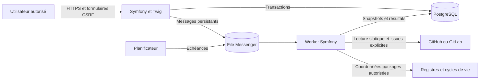
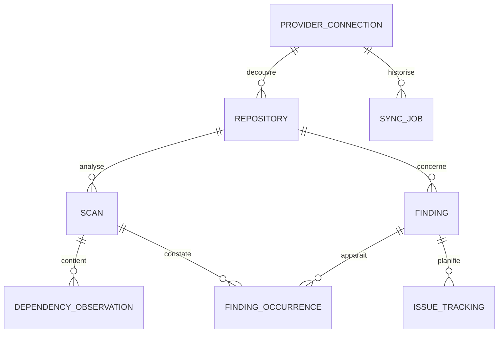

# Architecture

## État et sources

Les fondations Symfony, espace authentifié, thème et environnement local sont proposés en PR. Les diagrammes ci-dessous décrivent la cible ; fournisseurs, inventaire et moteur ne sont pas encore livrés. La mission ExoPulse élargit les références locales à plusieurs instances GitHub/GitLab et plusieurs centaines de dépôts.

## Organisation cible

La mission impose un monolithe modulaire Symfony 8, Doctrine/PostgreSQL, Twig/Symfony UX et Tailwind v4. L'équipe trace les adaptations dans les [ADR](adr/0001-monolithe-modulaire.md). Les modules métier sont Connexions, Inventaire, Analyse et Pilotage ; chacun sépare Domain, Application, Infrastructure et Presentation selon ses besoins. Une classe simple peut porter un cas d'utilisation sans couche ni interface supplémentaire.

Le domaine ne connaît ni HTTP ni GitHub/GitLab. Les contrats fournisseurs séparent lecture et gestion des issues. Les enrichissements externes conservent source et fraîcheur ; une indisponibilité produit une information inconnue ou périmée explicitement marquée.

## Modèle cible proposé

Un Repository représente aussi l'application dans le premier incrément ; éviter une seconde entité Application sans besoin de regroupement démontré. Identité interne stable et unicité `(connection_id, external_id)` empêchent les collisions entre instances. Les snapshots de scan restent attachés à une branche et un commit précis.

Prévoir index sur connexion/identité externe, repository/date de scan, état/date des jobs et empreinte de constat par repository/branche. Stocker versions et sources observées dans les snapshots ; les catalogues peuvent évoluer sans réécrire l'historique. La durée de conservation reste une question d'exploitation.

## Décisions à tracer

[0001 : monolithe](adr/0001-monolithe-modulaire.md), [0002 : traitements persistants](adr/0002-analyse-statique-asynchrone.md), [0003 : références visuelles](adr/0003-theme-exodia.md). Authentification définitive, distribution des clés de chiffrement et politique réseau nécessitent des ADR avant production.
