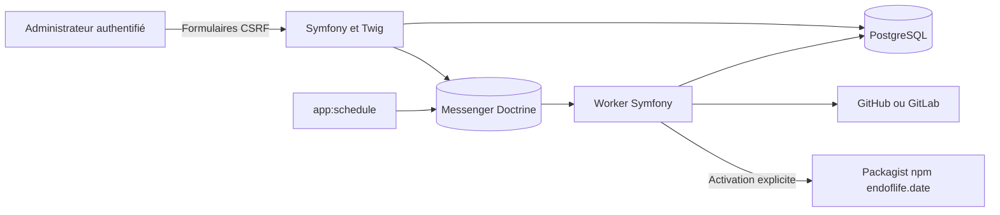
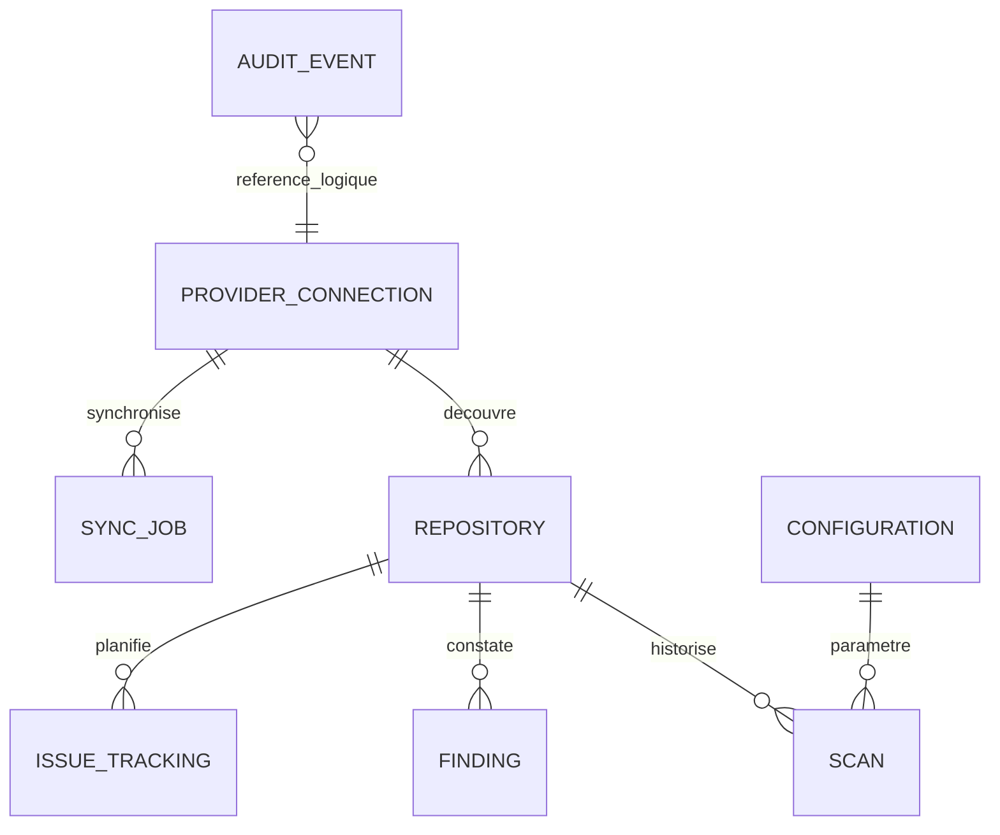

# Architecture implémentée

ExoPulse est un monolithe modulaire Symfony/Twig. `Domain` porte modèles, contrats Git et analyse ; `Application` orchestre les cas d’usage ; `Infrastructure` adapte Doctrine, APIs Git, chiffrement et catalogues ; `Presentation` contient contrôleurs, formulaires, commandes et fonctions Twig. Les contrôleurs délèguent les traitements longs à Messenger.

Le domaine ne dépend d’aucun SDK fournisseur. Les contrats de lecture et d’issues sont distincts. Un Repository représente une application : pas de double entité Application. Les observations de technologies et dépendances sont des snapshots JSON dans Scan, sans tables artificielles pour chaque ligne de lockfile.

Le diagramme Configuration/Audit indique des relations fonctionnelles, sans clés étrangères sur ces deux liens. Les huit tables métier sont versionnées par migrations. UUID internes et unicité `(connexion, ID externe)` résistent aux renommages et collisions de plateformes. Les constats sont identifiés par dépôt, branche et empreinte ; les scans conservent commit, preuves, dates et erreurs.

Les messages portent seulement des identifiants. Une transaction commune conserve job et message ; les verrous consultatifs PostgreSQL protègent les conteneurs concurrents. Les caches des contenus, versions et calendriers ont des durées indépendantes. Un commit inchangé évite la relecture des manifests, tout en permettant le rafraîchissement des métadonnées publiques autorisées.

Voir [persistance](persistence.md), [synchronisation](synchronization.md), [scans](scan-execution.md), [issues](issues.md), [planification](scheduling.md) et les [ADR](adr/0001-monolithe-modulaire.md). Le premier compte est un administrateur d’instance ; multi-tenant et SSO restent hors périmètre livré.
