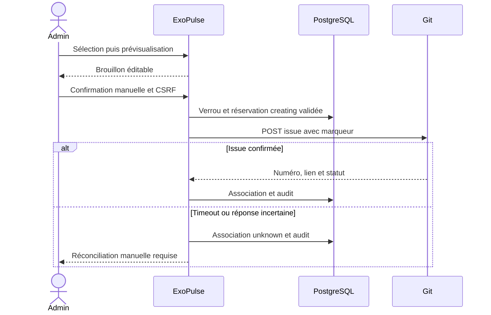

# Issues de migration

Depuis les constats d'une application ou la liste globale, un administrateur sélectionne entre 1 et 50 constats actifs d'une même application, puis prévisualise l'issue. La prévisualisation n'effectue aucune requête Git et ne crée aucune issue. Les identifiants invalides ou une sélection incohérente donnent HTTP 422 ; un constat absent donne HTTP 404.

Le brouillon contient les quatre sections « Contexte », « Objectif », « Travail attendu » et « Critères d'acceptation », les versions actuelles et cibles, la branche et les références disponibles. Une valeur inconnue reste « À vérifier ». Une mise à jour majeure doit faire vérifier les compatibilités avant migration. Le titre et le Markdown restent éditables ; les quatre sections doivent être conservées. Les limites sont 255 caractères pour le titre et 60 000 pour le corps.

La création exige une confirmation manuelle distincte. Elle est interdite pour une connexion désactivée, un repository inaccessible ou archivé. Les permissions de création du jeton sont vérifiées par le fournisseur lors du POST : les permissions de lecture ne garantissent pas la capacité de créer une issue. Les routes de prévisualisation, création et actualisation exigent `ROLE_ADMIN` et un jeton CSRF propre à l'action. Une session de lecture ne peut pas les utiliser.

## Doublons et concurrence

Un verrou partagé par repository sérialise les créations et les actualisations. Sous ce verrou, le repository et sa connexion sont relus depuis PostgreSQL avant toute requête Git. Une connexion désactivée, un repository non suivi, une organisation retirée ou un filtre d’inclusion/exclusion qui retire le dépôt interdisent la création comme l’actualisation manuelle. Une ancienne prévisualisation ou des constats historiques ne permettent pas de contourner ce périmètre. La prévisualisation reste consultative. Le déploiement doit utiliser le store PostgreSQL configuré du projet, commun aux workers et processus HTTP. Une contrainte unique `(repository_id, fingerprint)` protège la réservation en base. Le fingerprint regroupe les identités des constats triées ; les fingerprints des constats incluent leur branche dans le moteur d'analyse.

Une sélection déjà associée réutilise son issue, même si celle-ci est fermée. Une sélection différente qui recoupe une issue ouverte, en cours ou incertaine est bloquée et renvoie cette association existante. Les constats supplémentaires ne sont pas ajoutés automatiquement à son contenu : il faut ajuster la sélection pour les traiter séparément. L'application ne recherche pas les issues anciennes créées hors ExoPulse ; un marqueur `<!-- exopulse:<fingerprint> -->` ajouté au corps permet une recherche manuelle côté fournisseur.

Avant le POST externe, ExoPulse persiste et flush une réservation `creating` et une trace d'audit. En fonctionnement HTTP normal, cette réservation est validée en base avant la requête réseau. Ne pas envelopper ce cas d'utilisation dans une transaction englobant le POST : cela annulerait cette garantie. Un arrêt du processus après réservation conserve l'association et bloque une seconde création.

## Erreurs et réconciliation

Un refus HTTP 4xx, à l'exception d'un timeout HTTP 408, donne `failed` : le fournisseur a refusé la création. Après vérification des droits, du quota ou de la requête, une nouvelle confirmation manuelle peut retenter la création en réutilisant la réservation. Aucun retry automatique ne crée d'issue.

Un timeout, une panne réseau, un HTTP 5xx ou une réponse illisible donne `unknown`. L'issue peut déjà exister sur le fournisseur ; toute nouvelle création de cette sélection ou d'une sélection recoupant ses constats reste bloquée. Une réservation `creating` interrompue est traitée avec la même prudence. L'administrateur recherche le marqueur sur le fournisseur, vérifie que l'issue correspond aux constats, puis renseigne son numéro dans « Issues associées ». Le bouton d'association effectue uniquement un GET et conserve le lien retourné. L'association à un numéro existant est une décision explicite de l'administrateur ; l'API de statut n'expose pas le contenu permettant une vérification automatique du marqueur.

Les erreurs locales de configuration détectées avant toute requête externe empêchent la création sans réserver inutilement une association. Les erreurs affichées et auditées ne contiennent ni réponse brute du fournisseur ni token. Si une actualisation échoue, le dernier statut confirmé reste visible avec une erreur de vérification et sa date antérieure.

## Actualisations asynchrones

`RefreshIssue(issueId)` implémente `PortfolioMessage`. Son handler ne crée jamais d'issue et ignore les associations absentes, sans numéro confirmé, les connexions désactivées et les statuts vérifiés depuis moins de cinq minutes. Le verrou puis une nouvelle lecture de l'association évitent qu'une livraison répétée ne multiplie les appels GET après un succès.

Les erreurs réseau, quotas et 5xx peuvent être rejoués avec un délai compris entre 60 et 3 600 secondes. `Retry-After` est respecté dans cette borne et `forceRetry=false` laisse la stratégie Messenger limiter le nombre de tentatives. Les refus permanents sont conservés sans retry immédiat. Après une création ou une actualisation réussie, la prochaine vérification est fixée à six heures. La planification choisit les associations à actualiser ; ce handler ne planifie aucune création automatique.

## Vérifications

Les tests de service utilisent PostgreSQL réel et des réponses `MockHttpClient`, sans identifiant externe. Ils couvrent le brouillon, les chevauchements de sélection, une création incertaine sans second POST, la réconciliation, un refus puis une nouvelle confirmation, la sélection entre repositories, un constat résolu et les identifiants invalides. Un test observe la réservation depuis une connexion PostgreSQL distincte pendant le POST simulé pour vérifier sa validation préalable. Les tests HTTP vérifient les permissions, les CSRF, la validation de sélection, le rendu du brouillon et le parcours prévisualisation → confirmation → actualisation avec un fournisseur simulé.
