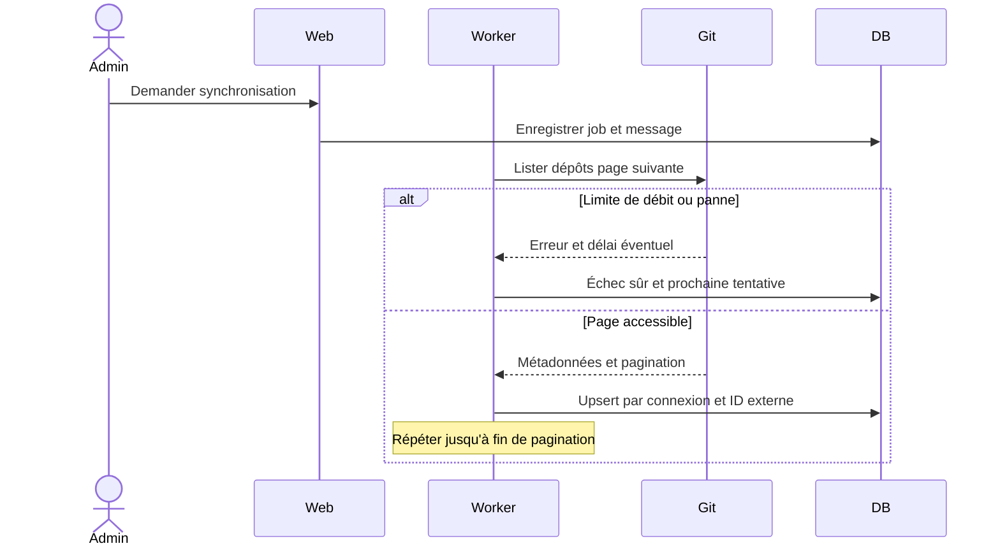

# Fournisseurs Git

## Statut

Contrats et comportements cibles ; aucun adaptateur opérationnel n'est affirmé ici. GitHub Cloud/Enterprise Server et GitLab SaaS/self-hosted doivent coexister, y compris plusieurs connexions de même type.

## Contrats

Un contrat de lecture teste l'accès, découvre les dépôts paginés, lit métadonnées et branches, puis des fichiers à un commit précis. Un contrat distinct gère création et statut des issues. Les objets renvoyés utilisent un modèle interne ; les identifiants externes restent des chaînes opaques et uniques dans leur connexion.

Chaque connexion porte nom, type, URL normalisée, méthode d'authentification, référence au secret protégé, organisations/groupes autorisés, inclusions/exclusions, branches, fréquence et activation. Aucune page ne renvoie le secret sauvegardé.

Les dépôts absents d'une réponse partielle ne sont pas supprimés. Archivé et inaccessible sont des états distincts. Un changement de nom conserve l'identité interne. La synchronisation mémorise dernier succès et erreurs expurgées.

## Sécurité et tests

La politique SSRF contrôle schéma HTTPS, hôte, résolution DNS et redirections. Autoriser une instance interne nécessite un hôte explicite ; ne pas ouvrir toutes les adresses privées. Désactiver les redirections non autorisées et conserver le contrôle à chaque requête. Les scopes minimums dépendent de la plateforme et de son édition ; vérifier les permissions de lecture puis d'écriture séparément.

Fixtures HTTP : plusieurs pages, ID externe identique dans deux connexions, token expiré, 403/404, 429 et `Retry-After`, timeout, dépôt archivé, sous-groupes, renommage et erreur partielle. Aucun test ne nécessite de token personnel.
