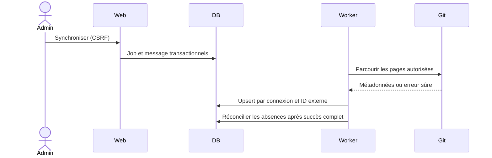

# Fournisseurs Git

GitHub Cloud/Enterprise Server et GitLab SaaS/self-hosted coexistent dans plusieurs connexions, y compris plusieurs instances du même fournisseur. L’authentification disponible repose sur un token personnel ou d’intégration ; OAuth et GitHub App ne sont pas implémentés.

Les contrats de lecture et d’issues sont séparés. La factory fournit l’adaptateur à partir d’une connexion ; le domaine reçoit des DTO normalisés et ne dépend d’aucun SDK GitHub/GitLab. Les identifiants externes sont opaques et uniques dans leur connexion.

Le formulaire définit nom, type, URL HTTPS, token chiffré, organisations/groupes, inclusions/exclusions, branches, fréquence et activation. Le token enregistré n’est jamais réaffiché. Une modification de fournisseur/instance exige une nouvelle connexion ; cela empêche de réattribuer les anciens identifiants à une autre instance.

## Connexion et périmètre

Configurer les hôtes autorisés dans `EXOPULSE_GIT_HOSTS`. Pour une instance privée, ajouter explicitement son hôte dans `EXOPULSE_INTERNAL_GIT_HOSTS`. Aucun wildcard, port arbitraire, identifiant dans l’URL ou redirection n’est accepté. Le client Symfony bloque les IP privées pour les hôtes publics et contrôle l’adresse réellement connectée.

GitHub Cloud utilise `api.github.com` ; Enterprise utilise le préfixe `/api/v3`. GitLab utilise `/api/v4`. Les groupes GitLab peuvent être des chemins ou identifiants numériques. Une modification d’organisations suspend la supervision des dépôts importés jusqu’à une nouvelle découverte ; un changement pendant une découverte annule le job.

L’accès en lecture exige métadonnées et contenus des dépôts autorisés. La création d’issues exige une permission d’écriture distincte : pour GitHub, accorder Contents/Metadata en lecture et Issues en écriture sur les seuls dépôts voulus ; pour GitLab, la lecture API/repository et l’écriture API dépendent du type de token et des droits sur le projet. Vérifier les permissions proposées par votre version et privilégier une connexion sans écriture tant que les issues ne sont pas utilisées.

## Synchronisation

Les renommages conservent l’identité. Archivé et inaccessible sont distincts ; les archives restent analysables. Une réponse partielle ne rend pas les dépôts absents inaccessibles. Quotas, permissions et indisponibilité ont des comportements de reprise distincts.

Voir [adaptateurs et tests](git-integration.md), [administration](connections.md) et [synchronisation](synchronization.md). Les tests HTTP simulés couvrent pagination, groupes, chemins encodés, refus/quotas, erreurs sûres et blocage réseau privé ; aucun token personnel n’est nécessaire.
