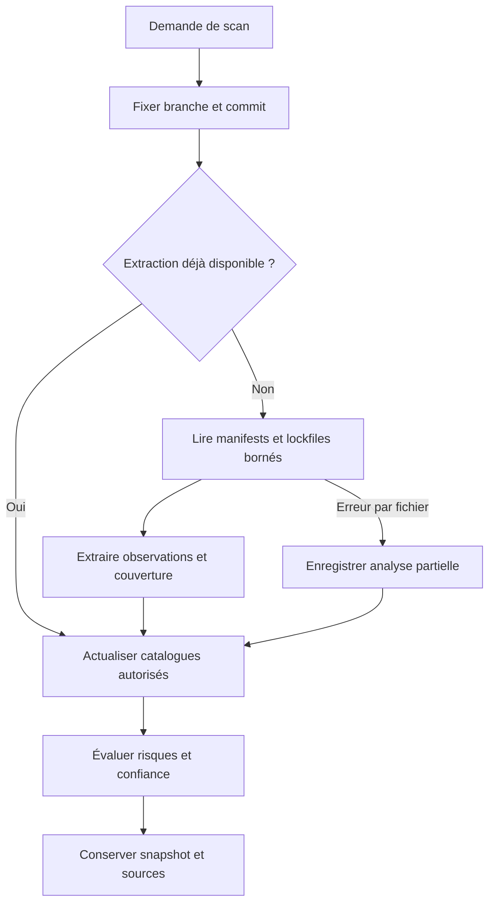
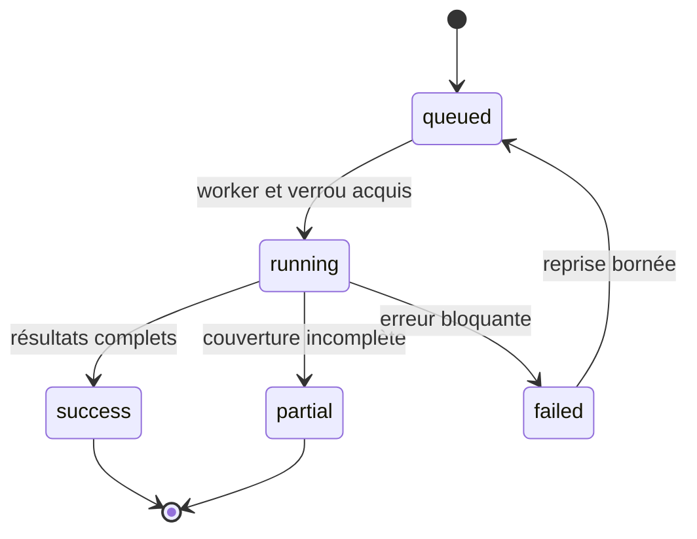
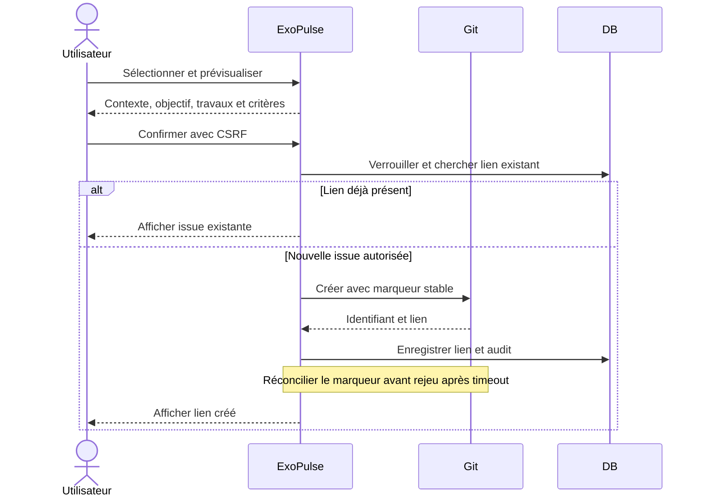

# Moteur d'analyse

## Statut et périmètre cible

Moteur à développer. Il reçoit des contenus de fichiers normalisés, indépendants de GitHub/GitLab. Il ne clone ni n'exécute le code. Les parseurs déclarent formats/versions acceptés ; un format non reconnu produit une couverture partielle, jamais une version inventée.

Composer, npm, pnpm et Yarn doivent conserver versions déclarées, résolues, dépendances directes et scopes identifiables. `.nvmrc`, `.node-version`, `.php-version`, Dockerfile et contraintes de manifests indiquent une intention de runtime. Une valeur dynamique ou ambiguë reste inconnue. Lire du JSON/YAML en mode données ; interdire scripts, imports et expansion de code.

## Enrichissement

Packagist/Composer et npm fournissent les versions. Les cycles de vie utilisent des sources officielles ou explicitement qualifiées. Conserver URL, date de consultation, série/version concernée et résultat. Les erreurs de cache et réseau affichent fraîcheur et inconnues. N'envoyer que les coordonnées de packages autorisées ; aucun fichier source privé ne quitte l'application.

Même à commit identique, actualiser les informations de versions/support puis réévaluer les constats. Différencier dernière stable et dernière compatible ; écarter les préversions sauf choix explicite. Une migration majeure exige une réserve de compatibilité. Une ancienne version ne suffit pas à prouver une vulnérabilité.

## Score proposé, à valider avant implémentation

Le besoin impose un score explicable entre 0 et 100 avec pondérations configurables. La formule et les seuils métier restent ouverts : ne pas publier de nombres provisoires. Proposition : contributions séparées runtime/framework hors support, obsolescences confirmées et vulnérabilités confirmées lorsqu'une source est intégrée ; plafonner chaque famille et versionner la politique. Présenter couverture, confiance et ancienneté hors du score. Si la couverture ne permet pas le calcul, afficher « Non calculable » avec raisons.

## Issues et résolution

Une empreinte stable identifie un constat dans un dépôt et une branche. Une occurrence de scan porte ses preuves. L'issue externe facilite la planification ; seul un scan concluant constate la résolution.

