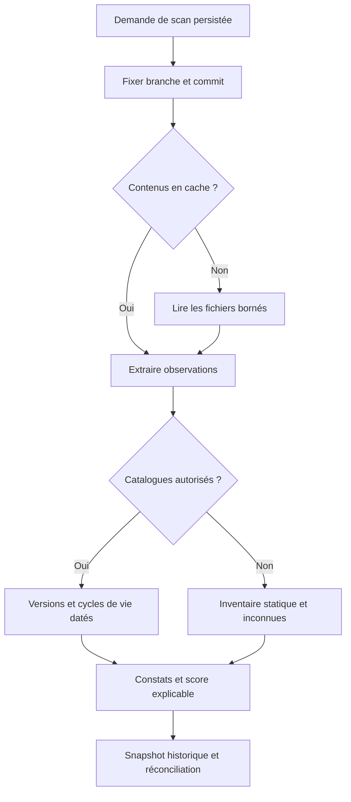

# Moteur d’analyse

Le moteur reçoit des contenus de fichiers normalisés, indépendants du fournisseur Git. Il ne clone, n’installe et n’exécute jamais le code analysé. Les parseurs lisent Composer, npm, pnpm et Yarn, y compris les formats anciens documentés dans [lecture des manifests](manifest-parsing.md).

Versions déclarées et résolues ne sont jamais assimilées. `.nvmrc`, `.node-version`, `.php-version`, Dockerfile et contraintes des manifests indiquent des intentions, pas le runtime effectivement déployé. Le verrouillage d’un package confirme sa résolution ; un lock absent conserve une information inconnue.

Les catalogues externes sont désactivés par défaut. Leur activation autorise l’envoi des noms et coordonnées de packages à Packagist/npm ; les calendriers PHP/Node/Symfony/Vue viennent de l’agrégateur communautaire endoflife.date, clairement identifié. Aucune date React n’est inventée. Source et date sont conservées avec chaque résultat.

## Santé

Poids par défaut : fin de support 40, fin de maintenance 10, majeure 10, mineure 3, patch 1. Chaque catégorie de support est plafonnée à 60 et chaque catégorie de mise à jour à 25. Formule : `max(0, 100 - somme des pénalités plafonnées)`. Les poids de 0 à 100 sont modifiables dans les paramètres.

Le calcul exige couverture d’au moins 50 et confiance de 100. Le score agrégé d’une application exige une analyse complète ; les résultats partiels peuvent afficher un score provisoire dans leur historique, sans classement rassurant. Un résultat de plus de sept jours par défaut est périmé et exclu des classements de santé actuels.

Bonne santé : 80–100 ; intervention : 50–79 ; critique : 0–49. Inconnu et périmé restent distincts des classes à risque. Couverture, confiance et fraîcheur sont visibles séparément. Les métriques et limites précises sont expliquées dans [implémentation](analysis-implementation.md) et [fraîcheur](freshness.md).

## Conservation des risques

Un scan complet peut résoudre les constats absents de sa branche. Un scan partiel, une panne de source ou une autre branche ne les efface pas. Une fermeture d’issue ne prouve aucune résolution. Le premier constat conserve sa date, ce qui rend visible l’ancienneté de l’obsolescence.

Aucune base d’avis de vulnérabilités n’est intégrée. Une version ancienne ou hors support n’est jamais qualifiée de vulnérabilité confirmée. Les mises à jour majeures et cibles de support restent des recommandations à vérifier, pas une promesse de compatibilité.

Voir [exécution, états et reprise](scan-execution.md), [catalogues](catalogs.md) et [gestion des issues](issues.md).
