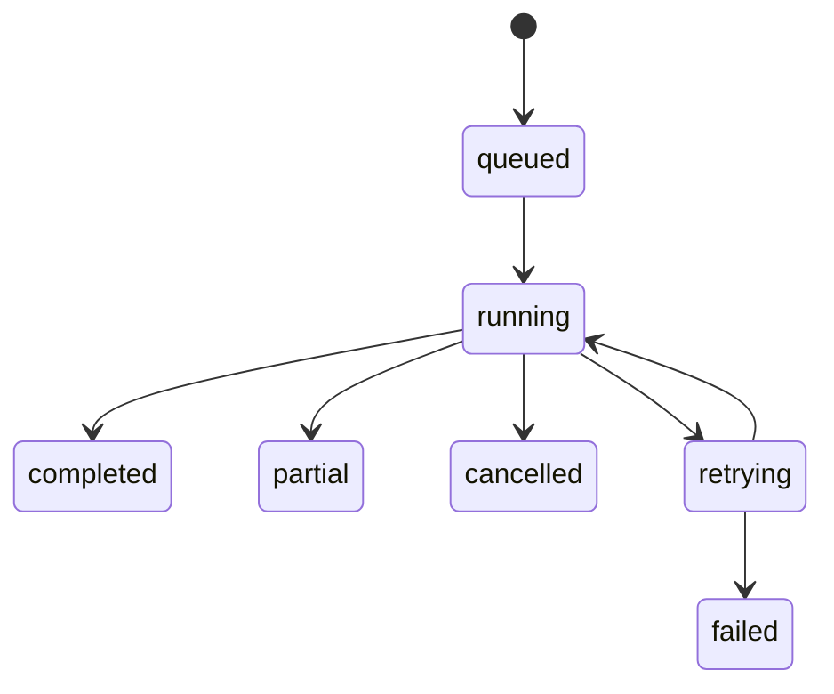

# Synchronisation persistante

Les demandes HTTP créent un SyncJob et un message Messenger dans une transaction PostgreSQL commune. Les demandes concurrentes sont dédupliquées par connexion ; les scans le sont par dépôt et branche. Les verrous consultatifs PostgreSQL couvrent tous les conteneurs et se libèrent à la déconnexion.

Le worker découvre les pages du fournisseur, conserve une identité `(connexion, identifiant externe)` et actualise les métadonnées sans exécuter le code distant. Une reprise réutilise les identités déjà enregistrées. Les dépôts archivés restent inventoriés. Les exclusions sont évaluées avant planification ; les groupes GitLab numériques sont autorisés seulement par une découverte sur ce groupe.

Seule une énumération complète marque les dépôts absents comme inaccessibles. Une interruption réseau conserve leur état précédent. Un changement de périmètre pendant l’énumération annule le job et retire la supervision jusqu’à une nouvelle découverte. La désactivation est vérifiée pendant le traitement.

Les erreurs 401/403 sans quota épuisé sont définitives. Les erreurs réseau, quotas et indisponibilités utilisent le backoff Messenger et son transport d’échec. Les délais distants sont bornés à une journée. Le listener de fin d’échec distingue `retrying` et `failed` ; les erreurs visibles ne contiennent aucun corps HTTP ni identifiant secret.

Après interruption d’un worker, le transport persistant redistribue le message non acquitté. Les handlers revérifient l’état sous verrou et ignorent les jobs déjà terminés. Les messages en échec peuvent être inspectés et relancés avec `messenger:failed:show` et `messenger:failed:retry`, après correction de la cause.
